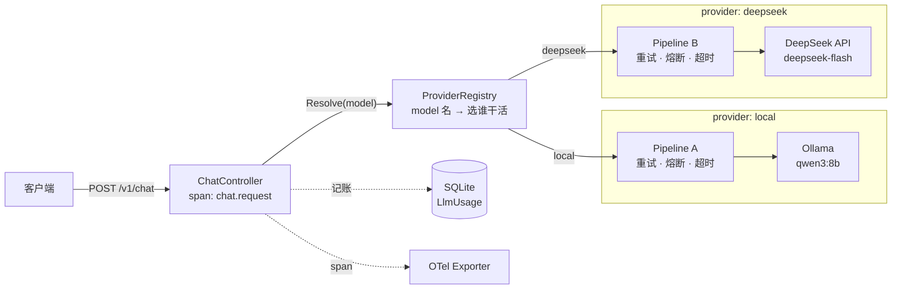
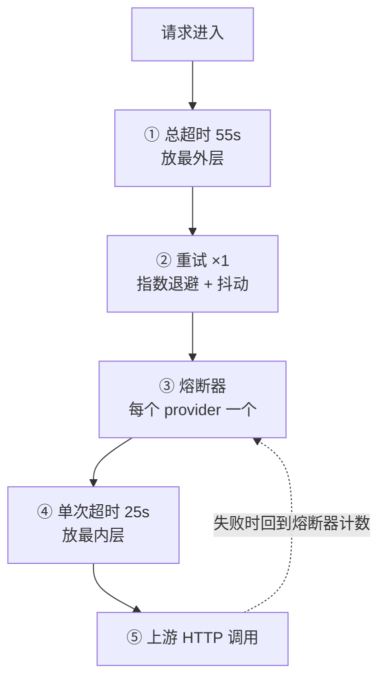

# LlmGateway

> 把 OpenAI / DeepSeek / Ollama 统一成一个接口 —— 带重试、熔断、计费和链路追踪。

## 它解决什么问题

每家 provider 的 SDK、参数名、错误码都不一样。业务代码直接对接，等于把「换模型」变成一次重构：

- OpenAI 用 `max_completion_tokens`，Ollama 只认 `max_tokens`，写错了**不报错，静默失效**
- 有的 provider 回传思考过程，有的不回
- 429 该退避多久、500 该重试几次，每家都不同

网关把这些差异收在一层里。业务只看一个地址、一种请求格式，**换模型改一行配置。**

## 3 分钟跑起来

前置条件：.NET 10 SDK（[下载](https://dotnet.microsoft.com/download)）。

```bash
git clone https://github.com/<your-name>/ai-journey.git
cd ai-journey/projects/LlmGateway

dotnet run
```

另开一个终端验证：

```bash
curl -s -o /dev/null -w "%{http_code}\n" http://localhost:5083/openapi/v1.json
# 200
```

或者直接用浏览器打开 <http://localhost:5083/> —— 会自动跳到 Swagger 文档页。

看到 Swagger UI 就说明服务起来了。

> 这一步只验证「服务起来了」，**不会调用任何模型** ——
> 所以不需要 API key、也不需要装 Ollama。
> 真正发对话请求时才需要 provider（见下面的「用起来」）。
> 如果这一步不通，先检查端口 5083 有没有被占用。

### 没有 .NET SDK 怎么办

自己发布一个自包含版本，连运行时都不用装：

```bash
dotnet publish -c Release -r win-x64 --self-contained true
# 产物在 bin/Release/net10.0/win-x64/publish/
# 整个目录拷到任何 Windows 机器上，双击 LlmGateway.exe 就能跑
```

想要单个文件就加 `-p:PublishSingleFile=true`（体积约 70MB，启动稍慢一点点）。

> 没有做 Docker 镜像，原因写在 Roadmap 里。

## 用起来

> **刚 clone 下来只有 `local` 能用。**
>
> `appsettings.Development.json` 不在仓库里（它存密钥，被 `.gitignore` 排除），
> 所以 `deepseek` 虽然会出现在启动横幅的模型列表里，**调用会返回 401**。
> 启动日志里也会有一条 `warn` 提示，这不是 bug。
>
> 要用云端模型，自己建这个文件：
>
> ```json
> { "Gateway": { "Providers": { "1": { "ApiKey": "sk-你的key" } } } }
> ```
>
> 为什么是 `"1"` 而不是整个 provider：JSON 配置里数组是**整体替换**，
> 只写一个元素会把 `local` 冲掉；用索引键才能只覆盖 `ApiKey` 这一个字段。
>
> 只想跑本地的话什么都不用配，但需要先 `ollama pull qwen3:8b`（约 5GB）。

### 非流式

```bash
curl -s http://localhost:5083/v1/chat \
  -H "Content-Type: application/json" \
  -H "X-User-Id: zhangsan" \
  -H "X-Department: tech" \
  -d '{"model":"qwen3:8b","messages":[{"role":"user","content":"hello"}]}'
```

```json
{
  "requestId": "ab0f2bf6d99f",
  "provider": "local",
  "model": "qwen3:8b",
  "text": "...",
  "usage": { "inputTokens": 18, "outputTokens": 6, "cachedInputTokens": 0 },
  "cost": null,
  "elapsedMs": 688
}
```

`cost` 为 `null` 表示这个 provider 没配价格（本地模型不计费）；配了价格的会返回具体金额。

### 流式（SSE）

```bash
curl -N http://localhost:5083/v1/chat \
  -H "Content-Type: application/json" \
  -d '{"model":"qwen3:8b","stream":true,"messages":[{"role":"user","content":"hello"}]}'
```

```
data: {"delta":"我"}
data: {"delta":"是"}
...
data: {"done":true,"requestId":"...","usage":{...},"elapsedMs":2450}
```

`-N` 关掉 curl 自己的缓冲，否则你会以为流式没生效。

### 几个约定

| 项 | 说明 |
|---|---|
| `model` | 决定路由到哪个 provider，不传用配置里的 `DefaultModel` |
| `X-User-Id` / `X-Department` | **只能是 ASCII**，中文会直接报编码错误。用 `tech` 而不是 `技术部` |
| 错误响应 | 统一 `{"error","errorType","requestId"}`，`errorType` 告诉你该不该重试 |

状态码含义：`400` 模型名写错 / 请求体有问题，`502` 上游挂了，`503` 熔断打开，`504` 超时。
**这几条分开的意义**：调用方能据此决定是改代码还是重试。

### 换模型

改 `appsettings.json` 里的 `Providers` 数组，重启即可。业务代码一行不用动。

> 中文提问在 Windows 的 curl 里会乱码，这是终端编码问题不是网关问题。
> 要么用 `-d @body.json`（把请求体写文件，UTF-8 编码），要么用 Postman / Swagger 页面。

## 架构



两个 provider 各有**独立的 Pipeline 和熔断器** —— 这是网关和单体应用最大的结构差别，下面详述。

| 组件 | 职责 | 文件 |
|---|---|---|
| ChatController | HTTP 入口、SSE 输出、错误码映射、记账调用 | `Chat/ChatController.cs` |
| ProviderRegistry | 路由表；每个 provider 一条韧性管道 | `Providers/ProviderRegistry.cs` |
| CostCalculator | 按 provider 各自的单价算钱 | `Billing/CostCalculator.cs` |
| UsageStore | 记账：写 SQLite；`Enabled=false` 时降级为结构化文本日志 | `Billing/UsageStore.cs` |
| GatewayTelemetry | 全局 ActivitySource | `Telemetry/GatewayTelemetry.cs` |

### 一次调用的韧性管道



**这个顺序不是随便排的，颠倒任意两层都会让保护失效：**

| 顺序错了 | 后果 |
|---|---|
| 熔断放在重试**外层** | 重试 4 次只记 1 次失败，阈值要 4 倍才触发；且每次都在往已挂的服务上打 4 次 |
| 总超时放在重试**内层** | 它只管单次，重试 4 次就是 4 × 50s，封不住用户等待时间 |
| 熔断器每条请求新建 | 状态不累积，**永远不打开**，而且不报错 |

### 四个不显然的设计决定

**① 熔断器按 provider 隔离，不共用。**

熔断器是有状态的。全网关共用一条 pipeline 的话，DeepSeek 挂了会把本地 Ollama
一起熔断 —— 网关自己变成单点故障，比不做熔断更糟。所以 pipeline 建在 provider
级别，client 建在 model 级别。

实测验证过：让 `broken` 这个指向死端口的 provider 熔断打开（返回 `503` 14ms），
同时调 `qwen3:8b` 仍然 `200`，694ms。

**② 重试只有一层。**

OpenAI SDK 默认自己会重试。外面再套 Polly，两者是**乘**的关系：
配 1 次重试实际打出 4 次请求（实测 `Retry failed after 4 tries`）。
所以创建 client 时显式 `RetryPolicy = new ClientRetryPolicy(maxRetries: 0)`，
把重试权交给 Polly 一家 —— 否则退避节奏、熔断计数全都不受你控制。

**③ 流式不重试。**

内容已经开始往客户端写了，重试会从头再写一遍，用户看到的是重复的两段话。
所以流式调用在 `ResilienceContext` 里打 `NoRetryKey` 标记，让同一条 pipeline
跳过重试 —— 用一条 pipeline 而不是两条，是为了让熔断状态只有一份。

**④ 用 MVC 而不是 Minimal API。**

这个项目要做成能复用的底座。真要复用到别的 AI 项目，接口会变成十几个
（模型列表、会话管理、组织配额……），那时 MVC 的分组、模型验证、过滤器
明显更省事。Minimal API 的优势只在「一两个端点」时成立 —— 端点一多，
那些省下来的样板要自己重新搭一遍。

代价也要认：Minimal API 的注册是显式的（`app.MapPost`），漏写就是静默 404；
MVC 靠约定自动发现，不会漏。**用 MVC 反而少了一类错误。**

## 不做什么

这是 v1 的范围，写在这里不是怕别人提需求，是**怕自己跑偏**。

| 不做的 | 为什么 |
|---|---|
| 缓存（精确 / 语义） | 缓存需要业务语义判断（哪些问题能缓存），不该由通用网关替使用方决定。见 Roadmap |
| UI / 前端 | `curl` 和 OpenAPI 文档够用 |
| 用户 / 权限 / 多租户 | 不在 v1 范围 |
| 向量检索 / RAG | 那是另一个项目 |
| 模型微调 / prompt 管理 | 永远不在这个项目里 |

## Roadmap（v1 之后）

- [ ] Docker 镜像（`docker compose up` 一键起）
- [ ] 可插拔的响应缓存接口（默认关闭，由使用方实现判断逻辑）
- [ ] 按 provider 的成本报表
- [ ] 多租户与配额
- [ ] Prometheus 指标导出

> **为什么 v1 没做 Docker**：门槛是「陌生人 10 分钟跑起来」，而 `dotnet run`
> 已经满足了 —— 这个项目的读者大概率有 .NET SDK。加 Docker 意味着陌生人要
> 额外拉两个镜像（sdk 约 800MB + aspnet 约 220MB），对 .NET 项目反而是负担。
> 「不装 SDK 也能跑」这条需求，用自包含发布解决更轻。

## 技术栈

| 层 | 选型 |
|---|---|
| Web | ASP.NET Core MVC (.NET 10) |
| LLM 抽象 | Microsoft.Extensions.AI |
| 韧性 | Polly v8（重试 / 超时 / 熔断） |
| 计费 | SQLite（v1）→ PostgreSQL（后续） |
| 追踪 | OpenTelemetry |
| 测试 | xUnit + 手写 FakeChatClient |

## 许可

MIT
