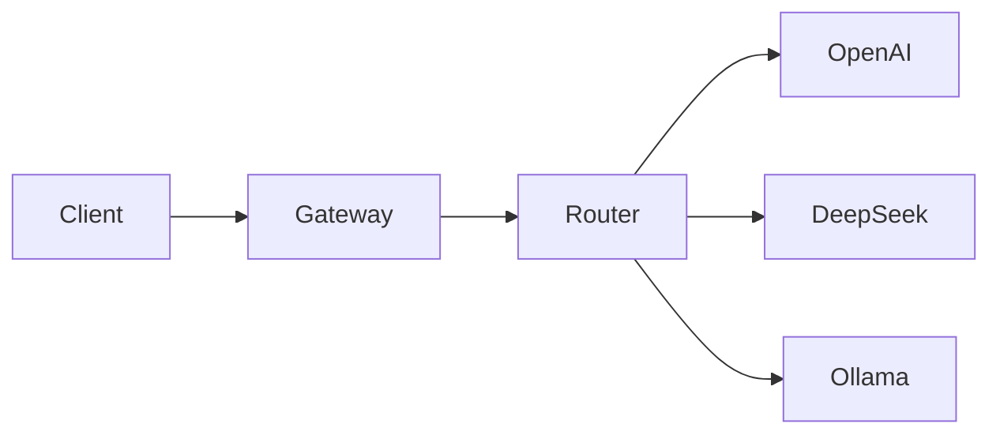

# LlmGateway

> 把 OpenAI / DeepSeek / Ollama 统一成一个接口 —— 带重试、熔断、计费和链路追踪。

## 它解决什么问题

每家 provider 的 SDK、参数名、错误码都不一样。业务代码直接对接，等于把「换模型」变成一次重构：

- OpenAI 用 `max_completion_tokens`，Ollama 只认 `max_tokens`，写错了**不报错，静默失效**
- 有的 provider 回传思考过程，有的不回
- 429 该退避多久、500 该重试几次，每家都不同

网关把这些差异收在一层里。业务只看一个地址、一种请求格式，**换模型改一行配置。**

## 3 分钟跑起来

前置条件：.NET 10 SDK（[下载](https://dotnet.microsoft.com/download)）。

```bash
git clone https://github.com/<your-name>/ai-journey.git
cd ai-journey/projects/LlmGateway

dotnet run
```

另开一个终端验证：

```bash
curl -s -o /dev/null -w "%{http_code}\n" http://localhost:5083/openapi/v1.json
# 200
```

或者直接用浏览器打开 <http://localhost:5083/> —— 会自动跳到 Swagger 文档页。

看到 Swagger UI 就说明服务起来了。

> 这一步**不连任何模型**，所以不需要 API key、不需要装 Ollama。
> 如果这一步不通，先检查端口 5083 有没有被占用。

<!-- TODO: D3 补 docker-compose 一键启动 -->

## 用起来

<!-- TODO: 第一个 chat 接口做完后填，格式参考：

curl -X POST http://localhost:5083/v1/chat \
  -H "Content-Type: application/json" \
  -d '{"provider":"ollama","model":"qwen3:8b","message":"你好"}'
-->

## 架构

<!-- TODO: D5 补 mermaid 架构图


-->

## 不做什么

这是 v1 的范围，写在这里不是怕别人提需求，是**怕自己跑偏**。

| 不做的 | 为什么 |
|---|---|
| 缓存（精确 / 语义） | 缓存需要业务语义判断（哪些问题能缓存），不该由通用网关替使用方决定。见 Roadmap |
| UI / 前端 | `curl` 和 OpenAPI 文档够用 |
| 用户 / 权限 / 多租户 | 不在 v1 范围 |
| 向量检索 / RAG | 那是另一个项目 |
| 模型微调 / prompt 管理 | 永远不在这个项目里 |

## Roadmap（v1 之后）

- [ ] 可插拔的响应缓存接口（默认关闭，由使用方实现判断逻辑）
- [ ] 按 provider 的成本报表
- [ ] 多租户与配额
- [ ] Prometheus 指标导出

## 技术栈

| 层 | 选型 |
|---|---|
| Web | ASP.NET Core Minimal API (.NET 10) |
| LLM 抽象 | Microsoft.Extensions.AI |
| 韧性 | Polly v8（重试 / 超时 / 熔断） |
| 计费 | SQLite（v1）→ PostgreSQL（后续） |
| 追踪 | OpenTelemetry |
| 测试 | xUnit + 手写 FakeChatClient |

## 许可

MIT
